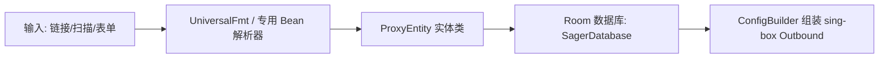
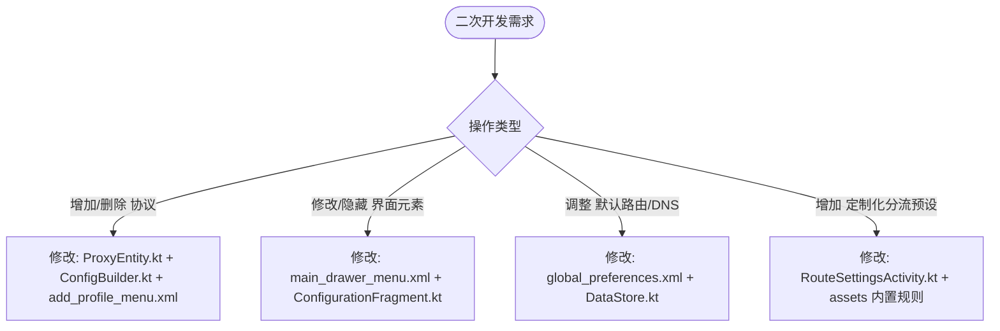

# NekoBoxForAndroid 功能讲解说明书（净室设计功能规格书）

> **编写原则说明**：本说明书严格遵循约 80% ASD-STE100（简明技术英文）中文规范。采用短句、主谓明确、指令与描述分离、术语统一、排除歧义词汇，便于初学者理解系统全貌并指导二次开发。

---

## 第一部分：软件全功能资产矩阵（Overview Matrix）

NekoBoxForAndroid 是一款基于 Android 系统的通用网络代理客户端。软件以 **sing-box 1.14.0** 为核心转发引擎（已完成 1.12 至 1.14 核心升级），包含 **7 大业务模块**：

| 模块编号 | 业务模块名称 | 核心功能数 | 主要代码承载目录 |
| :--- | :--- | :--- | :--- |
| **M1** | 节点与代理协议管理 | 17 项协议 / 3 类配置模式 | `moe.matsuri.nb4a.proxy`, `io.nekohasekai.sagernet.fmt` |
| **M2** | 订阅与分组管理 | 7 项核心功能 | `io.nekohasekai.sagernet.ui.Group*`, `database` |
| **M3** | 路由分流与应用控制 | 5 项核心功能 | `io.nekohasekai.sagernet.ui.Route*`, `AppManager*` |
| **M4** | DNS 与域名解析系统 | 6 项核心功能 | `res/xml/global_preferences.xml`, `ConfigBuilder.kt` |
| **M5** | 运行服务与网络栈模式 | 4 项核心功能 | `io.nekohasekai.sagernet.bg.*` |
| **M6** | 监控、诊断与系统集成 | 6 项核心功能 | `ui.WebviewFragment`, `StunActivity`, `TileService` |
| **M7** | 数据备份与扩展插件 | 4 项核心功能 | `ui.BackupFragment`, `moe.matsuri.nb4a.plugin` |

---

## 第二部分：逐模块功能深度规格讲解

---

### M1. 节点与代理协议管理模块

#### 1. 功能定义
该模块负责创建、解析、存储和构建单节点代理配置与链式代理配置。

#### 2. 支持功能清单
1. **多协议出站支持**：
   - 基础标准协议：SOCKS5、HTTP/HTTPS、Shadowsocks、VMess、VLESS、Trojan、SSH、WireGuard。
   - 现代与专用协议：Trojan-Go、NaiveProxy、Hysteria、TUIC、ShadowTLS、AnyTLS、Mieru。
2. **节点录入方式**：
   - 手动表单填写创建。
   - 二维码扫描录入（Camera / ZXing）。
   - 剪贴板链接批量导入（支持 `vmess://`, `ss://`, `trojan://`, `hysteria://`, `sn://` 等）。
   - 本地配置文件导入（JSON / sing-box 配置）。
3. **链式代理（Proxy Chain）**：
   - 允许将多个单节点组合为前后级联的跳板代理链。
4. **自定义配置节点（Custom Config）**：
   - 允许直接写入 sing-box 原生 JSON 出站结构。

#### 3. 数据与逻辑流向


#### 4. 二次开发定位点
- **数据结构定义**：[ProxyEntity.kt](file:///d:/edge/ft/scripts/NekoBoxForAndroid/app/src/main/java/io/nekohasekai/sagernet/database/ProxyEntity.kt)
- **协议出站组装器**：[ConfigBuilder.kt](file:///d:/edge/ft/scripts/NekoBoxForAndroid/app/src/main/java/io/nekohasekai/sagernet/fmt/ConfigBuilder.kt)
- **添加菜单配置**：[add_profile_menu.xml](file:///d:/edge/ft/scripts/NekoBoxForAndroid/app/src/main/res/menu/add_profile_menu.xml)
- **协议编辑界面包**：`io.nekohasekai.sagernet.ui.profile.*` 与 `moe.matsuri.nb4a.proxy.*`

---

### M2. 订阅与分组管理模块

#### 1. 功能定义
该模块对节点进行集合化管理。支持远程订阅同步、批量节点测试与自动化清洗。

#### 2. 支持功能清单
1. **分组类型分类**：
   - 普通本地分组（Local Group）。
   - 远程订阅分组（Subscription Group）。
2. **订阅生命周期管理**：
   - 手动触发更新。
   - 定时自动更新（后台 WorkManager / Alarm 调度）。
   - 仅在代理连通时更新（避免直连阻断）。
   - 自定义 User-Agent 请求头。
3. **节点批量测试**：
   - TCP Ping 测速（网络层连通性）。
   - URL Test 真连接测试（应用层可用性，使用 HTTP HEAD/GET）。
4. **节点数据清洗与排序**：
   - 节点去重（根据协议、目标地址与端口计算 Hash）。
   - 删除不可用节点（一键清理超时节点）。
   - 排序规则切换：原始顺序、按节点名称排序、按测试延迟排序。
5. **前置/落地代理绑定**：
   - 允许对整个分组绑定全局前置代理（Front Proxy）或落地代理（Landing Proxy）。

#### 3. 二次开发定位点
- **分组界面承载**：[GroupFragment.kt](file:///d:/edge/ft/scripts/NekoBoxForAndroid/app/src/main/java/io/nekohasekai/sagernet/ui/GroupFragment.kt)
- **分组设置界面**：[GroupSettingsActivity.kt](file:///d:/edge/ft/scripts/NekoBoxForAndroid/app/src/main/java/io/nekohasekai/sagernet/ui/GroupSettingsActivity.kt)
- **分组属性定义**：[group_preferences.xml](file:///d:/edge/ft/scripts/NekoBoxForAndroid/app/src/main/res/xml/group_preferences.xml)
- **订阅更新引擎**：[SubscriptionUpdater.kt](file:///d:/edge/ft/scripts/NekoBoxForAndroid/app/src/main/java/io/nekohasekai/sagernet/bg/SubscriptionUpdater.kt)

---

### M3. 路由分流与应用控制模块

#### 1. 功能定义
该模块控制设备流量走向。决定网络请求通过直连（Direct）、代理（Proxy）或阻断（Block）。

#### 2. 支持功能清单
1. **分流规则集定义（Routing Rules）**：
   - 支持多维匹配条件：域名（Domain）、目标 IP（Dst IP）、目标端口（Dst Port）、源 IP（Src IP）、源端口（Src Port）、网络协议（TCP/UDP/Network）。
   - 匹配动作：直连（Direct）、出站代理（Proxy）、阻断（Block）。
2. **规则资源包管理（Assets 管理）**：
   - 内置并支持外部更新 `geosite.dat` 与 `geoip.dat` 规则库。
   - 支持自定义规则集提供商（Rules DAT Provider）。
3. **分应用代理模式（Per-App Proxy）**：
   - 白名单模式：仅允许选中的应用走代理。
   - 黑名单模式：选中的应用绕过代理直连。
4. **局域网绕过（Bypass LAN）**：
   - 自动识别并直连本地私网网段（如 `192.168.0.0/16`, `10.0.0.0/8`）。
   - 支持系统级路由表绕过，或内核内部判定绕过（Bypass LAN in Core）。
5. **流量探测（Traffic Sniffing）**：
   - 针对 TLS、HTTP 握手包进行内容探测，提取真实域名重放分流。

#### 3. 二次开发定位点
- **路由规则列表界面**：[RouteFragment.kt](file:///d:/edge/ft/scripts/NekoBoxForAndroid/app/src/main/java/io/nekohasekai/sagernet/ui/RouteFragment.kt)
- **路由规则编辑界面**：[RouteSettingsActivity.kt](file:///d:/edge/ft/scripts/NekoBoxForAndroid/app/src/main/java/io/nekohasekai/sagernet/ui/RouteSettingsActivity.kt)
- **分应用选择界面**：[AppManagerActivity.kt](file:///d:/edge/ft/scripts/NekoBoxForAndroid/app/src/main/java/io/nekohasekai/sagernet/ui/AppManagerActivity.kt)
- **规则实体定义**：[RuleEntity.kt](file:///d:/edge/ft/scripts/NekoBoxForAndroid/app/src/main/java/io/nekohasekai/sagernet/database/RuleEntity.kt)

---

### M4. DNS 与域名解析系统

#### 1. 功能定义
该模块管理所有域名解析过程。防止 DNS 污染并支持分流决策。

#### 2. 支持功能清单
1. **双轨 DNS 架构**：
   - **远程 DNS（Remote DNS）**：通过代理隧道查询，主要处理境外或受阻断域名（默认支持 DoH/DoT 如 `https://dns.google/dns-query`）。
   - **直连 DNS（Direct DNS）**：直连本地网络查询，加速境内域名访问（默认 `https://223.5.5.5/dns-query`）。
2. **FakeDNS 伪装解析**：
   - 分配内部虚拟 IP（如 `198.18.0.0/15`）给目标域名。
   - 延迟实际 DNS 解析到远端代理服务器，减少客户端本地解析开销与泄露。
3. **域名解析策略（Domain Strategy）**：
   - 支持独立设置 Direct、Remote 和 Server 域名的解析策略：`AsIs`、`UseIP`、`UseIPv4`、`UseIPv6`。
4. **DNS 路由（DNS Routing）**：
   - 劫持客户端发送的所有 53 端口 UDP/TCP 请求，重定向到内部 DNS 处理管道。

#### 3. 二次开发定位点
- **全局 DNS 设置 XML**：[global_preferences.xml](file:///d:/edge/ft/scripts/NekoBoxForAndroid/app/src/main/res/xml/global_preferences.xml#L143-L189)
- **DNS 逻辑拼装**：[ConfigBuilder.kt](file:///d:/edge/ft/scripts/NekoBoxForAndroid/app/src/main/java/io/nekohasekai/sagernet/fmt/ConfigBuilder.kt)

---

### M5. 运行服务与网络栈模式

#### 1. 功能定义
该模块作为系统与代理内核之间的桥梁，管理进程生命周期与虚拟网卡。

#### 2. 支持功能清单
1. **双运行模式**：
   - **VPN 模式**：通过调用 Android `VpnService` 创建 `tun` 虚拟网卡，全系统流量透明接管。
   - **仅代理模式（Proxy Only）**：不开启 VPN 网卡，只在本地开启统一混合代理端口（Mixed Port: SOCKS5/HTTP），供手动设置代理。
2. **TUN 虚拟网卡实现切换**：
   - 支持 gVisor、System 或 Mixed 等不同 TUN 栈实现（平衡内存占用与网络吞吐性能）。
3. **网络参数调优**：
   - MTU 动态设定（默认 1280，适配移动网络）。
   - 允许局域网共享（Allow Access from LAN）：将本地入站端口对外监听。
   - 网络切换重置连接（Network Change Reset Connections）。
   - 保持 CPU 唤醒锁（Wake Lock）防止后台休眠断连。

#### 3. 二次开发定位点
- **VPN 核心服务**：[VpnService.kt](file:///d:/edge/ft/scripts/NekoBoxForAndroid/app/src/main/java/io/nekohasekai/sagernet/bg/VpnService.kt)
- **仅代理模式服务**：[ProxyService.kt](file:///d:/edge/ft/scripts/NekoBoxForAndroid/app/src/main/java/io/nekohasekai/sagernet/bg/ProxyService.kt)
- **服务基类与连接绑定**：[BaseService.kt](file:///d:/edge/ft/scripts/NekoBoxForAndroid/app/src/main/java/io/nekohasekai/sagernet/bg/BaseService.kt)

---

### M6. 监控、诊断与系统集成

#### 1. 功能定义
提供流量状态反馈、实时连接监控、网络诊断及系统快捷方式集成。

#### 2. 支持功能清单
1. **嵌入式 Clash API 与 Dashboard 仪表盘**：
   - 内部集成轻量级 Clash RESTful API。
   - 通过 Webview 内嵌载入 YACD（Yet Another Clash Dashboard）控制台，实时查看实时连接、策略组切换与上传下载流速。
2. **实时通知与状态栏组件**：
   - 前台服务常驻通知，显示当前节点名称、瞬时上下行网速、总消耗流量。
   - 状态栏快速设置磁贴（Quick Settings Tile）：支持一键连接/断开。
   - 快捷桌面微件与应用快捷方式（Shortcuts）。
3. **网络诊断工具箱**：
   - STUN / NAT 类型检测测试器：判定当前网络 NAT 模式（Full Cone、Restricted 等）。
   - 实时内核日志分析面板（LogcatFragment）：彩色区分 `INFO`、`WARN`、`ERROR`。

#### 3. 二次开发定位点
- **Webview 仪表盘**：[WebviewFragment.kt](file:///d:/edge/ft/scripts/NekoBoxForAndroid/app/src/main/java/io/nekohasekai/sagernet/ui/WebviewFragment.kt)
- **系统快速磁贴**：[TileService.kt](file:///d:/edge/ft/scripts/NekoBoxForAndroid/app/src/main/java/io/nekohasekai/sagernet/bg/TileService.kt)
- **NAT 测试实现**：[StunActivity.kt](file:///d:/edge/ft/scripts/NekoBoxForAndroid/app/src/main/java/io/nekohasekai/sagernet/ui/StunActivity.kt)
- **日志渲染器**：[LogcatFragment.kt](file:///d:/edge/ft/scripts/NekoBoxForAndroid/app/src/main/java/io/nekohasekai/sagernet/ui/LogcatFragment.kt)

---

### M7. 数据备份与扩展插件

#### 1. 功能定义
提供用户数据持久化备份能力，并支持解耦的独立协议可执行文件。

#### 2. 支持功能清单
1. **全局备份与还原**：
   - 导出为 JSON 备份文件（包含所有分组、节点实体、路由规则及偏好设置）。
   - 支持从本地文件还原配置并自动重启应用进程。
2. **外部独立插件架构（Plugin Manager）**：
   - 基于 Android `ContentProvider` 跨进程安全沙盒，查找并调用外部独立打包的二进制可执行插件（例如 `moe.matsuri.exe.*` 或 `io.nekohasekai.sagernet.plugin.*`）。
   - 插件用于执行主包体积限制以外的独立协议核心。

#### 3. 二次开发定位点
- **备份与还原界面**：[BackupFragment.kt](file:///d:/edge/ft/scripts/NekoBoxForAndroid/app/src/main/java/io/nekohasekai/sagernet/ui/BackupFragment.kt)
- **插件发现机制**：[Plugins.kt](file:///d:/edge/ft/scripts/NekoBoxForAndroid/app/src/main/java/moe/matsuri/nb4a/plugin/Plugins.kt)

---

## 第三部分：二次开发（增、删、改、查）快速实施指南

当你作为初学者计划修改此项目时，请对照下表操作，避免盲目修改导致编译或运行故障：



### 1. 增加功能示例（如：新增一种自定义代理协议）
- **步骤 1**：在 [ProxyEntity.kt](file:///d:/edge/ft/scripts/NekoBoxForAndroid/app/src/main/java/io/nekohasekai/sagernet/database/ProxyEntity.kt) 中定义常量 `TYPE_NEW_PROTOCOL`，并新增对应的 `NewBean` 属性。
- **步骤 2**：在 [add_profile_menu.xml](file:///d:/edge/ft/scripts/NekoBoxForAndroid/app/src/main/res/menu/add_profile_menu.xml) 增加一个菜单项。
- **步骤 3**：新建 `NewProtocolSettingsActivity` 供用户输入参数。
- **步骤 4**：在 [ConfigBuilder.kt](file:///d:/edge/ft/scripts/NekoBoxForAndroid/app/src/main/java/io/nekohasekai/sagernet/fmt/ConfigBuilder.kt) 中编写将 `NewBean` 转换为 sing-box JSON Outbound 对象的构建方法。

### 2. 删除功能示例（如：精简不需要的功能，如移除 YACD 仪表盘或推广项）
- **步骤 1**：在 [main_drawer_menu.xml](file:///d:/edge/ft/scripts/NekoBoxForAndroid/app/src/main/res/menu/main_drawer_menu.xml) 移除 `nav_traffic` 或 `nav_tuiguang`。
- **步骤 2**：在 [MainActivity.kt](file:///d:/edge/ft/scripts/NekoBoxForAndroid/app/src/main/java/io/nekohasekai/sagernet/ui/MainActivity.kt) 中注销对应事件分发。
- **步骤 3**：安全删除 [WebviewFragment.kt](file:///d:/edge/ft/scripts/NekoBoxForAndroid/app/src/main/java/io/nekohasekai/sagernet/ui/WebviewFragment.kt)。

### 3. 修改功能示例（如：锁定默认配置，禁止用户修改 DNS 或强制指定直连规则）
- **步骤 1**：修改 [global_preferences.xml](file:///d:/edge/ft/scripts/NekoBoxForAndroid/app/src/main/res/xml/global_preferences.xml)，设置控件的 `android:enabled="false"` 或隐藏该配置项。
- **步骤 2**：在 [DataStore.kt](file:///d:/edge/ft/scripts/NekoBoxForAndroid/app/src/main/java/io/nekohasekai/sagernet/database/DataStore.kt) 中将对应键值写死为固定默认值。

---

## 第四部分：本项目二次开发定制（二改）与功能增强记录

本部分完整记录本项目相较于原版代码仓库的所有二次开发定制（二改）、缺陷修复及核心架构升级。

### 1. 二次开发定制对照总表

| 编号 | 变更分类 | 变更功能点 | 涉及核心文件与定位 | 状态 |
| :--- | :--- | :--- | :--- | :--- |
| **C1** | 稳定性修复 | 剪贴板导入空指针保护（NPE 防护） | [ConfigurationFragment.kt](file:///d:/edge/ft/scripts/NekoBoxForAndroid/app/src/main/java/io/nekohasekai/sagernet/ui/ConfigurationFragment.kt) | 已验证 |
| **C2** | 默认策略优化 | DNS 路由与备用 FakeDNS 默认关闭 | [DataStore.kt](file:///d:/edge/ft/scripts/NekoBoxForAndroid/app/src/main/java/io/nekohasekai/sagernet/database/DataStore.kt), [global_preferences.xml](file:///d:/edge/ft/scripts/NekoBoxForAndroid/app/src/main/res/xml/global_preferences.xml) | 已验证 |
| **C3** | 业务逻辑纠偏 | 初始分组解耦与新建分组名称空白预填 | [GroupManager.kt](file:///d:/edge/ft/scripts/NekoBoxForAndroid/app/src/main/java/io/nekohasekai/sagernet/database/GroupManager.kt), [GroupSettingsActivity.kt](file:///d:/edge/ft/scripts/NekoBoxForAndroid/app/src/main/java/io/nekohasekai/sagernet/ui/GroupSettingsActivity.kt), [group_preferences.xml](file:///d:/edge/ft/scripts/NekoBoxForAndroid/app/src/main/res/xml/group_preferences.xml) | 已验证 |
| **C4** | 视觉体验定制 | 全局默认主题色更改为青色（Cyan） | [Theme.kt](file:///d:/edge/ft/scripts/NekoBoxForAndroid/app/src/main/java/io/nekohasekai/sagernet/utils/Theme.kt), [DataStore.kt](file:///d:/edge/ft/scripts/NekoBoxForAndroid/app/src/main/java/io/nekohasekai/sagernet/database/DataStore.kt) | 已验证 |
| **C5** | 底层引擎升级 | sing-box 内核升级至 1.14.0 核心 | [libcore.aar](file:///d:/edge/ft/scripts/NekoBoxForAndroid/app/libs/libcore.aar), [libcore.aar.bak](file:///d:/edge/ft/scripts/NekoBoxForAndroid/app/libs/libcore.aar.bak) | 已验证 |
| **C6** | 监控展示增强 | 底栏右侧新增出口 IP + 旗帜 Emoji + 地理位置 | [StatsBar.kt](file:///d:/edge/ft/scripts/NekoBoxForAndroid/app/src/main/java/io/nekohasekai/sagernet/widget/StatsBar.kt), [layout_main.xml](file:///d:/edge/ft/scripts/NekoBoxForAndroid/app/src/main/res/layout/layout_main.xml) | 已验证 |
| **C7** | 布局交互优化 | 测速延迟文本独立通栏展示，消除末尾截断 | [layout_main.xml](file:///d:/edge/ft/scripts/NekoBoxForAndroid/app/src/main/res/layout/layout_main.xml), [StatsBar.kt](file:///d:/edge/ft/scripts/NekoBoxForAndroid/app/src/main/java/io/nekohasekai/sagernet/widget/StatsBar.kt) | 已验证 |
| **C8** | 发布工程构建 | 集成 Release 独立标准签名与 apksigner 验证 | [local.properties](file:///d:/edge/ft/scripts/NekoBoxForAndroid/local.properties), [release.keystore](file:///d:/edge/ft/scripts/NekoBoxForAndroid/release.keystore) | 已验证 |
| **C9** | 传输层修复 | Cloudflare VLESS WS 路径参数与 proxyip 完整保留 | [V2RayFmt.kt](file:///d:/edge/ft/scripts/NekoBoxForAndroid/app/src/main/java/io/nekohasekai/sagernet/fmt/v2ray/V2RayFmt.kt) | 已验证 |
| **C10** | 快捷操作增强 | 主界面右上角一键分流模式切换（规则/全局/直连） | [add_profile_menu.xml](file:///d:/edge/ft/scripts/NekoBoxForAndroid/app/src/main/res/menu/add_profile_menu.xml), [ConfigurationFragment.kt](file:///d:/edge/ft/scripts/NekoBoxForAndroid/app/src/main/java/io/nekohasekai/sagernet/ui/ConfigurationFragment.kt) | 已验证 |
| **C11** | 路由策略重构 | 分流规则四层分级体系与用户自定义规则绝对置顶 | [ConfigBuilder.kt](file:///d:/edge/ft/scripts/NekoBoxForAndroid/app/src/main/java/io/nekohasekai/sagernet/fmt/ConfigBuilder.kt) | 已验证 |
| **C12** | 隐私泄露防御 | WebRTC STUN 端口阻断与 Fake-IP 混合入站覆盖 | [ConfigBuilder.kt](file:///d:/edge/ft/scripts/NekoBoxForAndroid/app/src/main/java/io/nekohasekai/sagernet/fmt/ConfigBuilder.kt) | 已验证 |
| **C13** | 诊断监控原生化 | 实时连接与分流命中监视器（侧边栏原生集成） | [ConnectionsFragment.kt](file:///d:/edge/ft/scripts/NekoBoxForAndroid/app/src/main/java/io/nekohasekai/sagernet/ui/ConnectionsFragment.kt), [main_drawer_menu.xml](file:///d:/edge/ft/scripts/NekoBoxForAndroid/app/src/main/res/menu/main_drawer_menu.xml) | 已验证 |
| **C14** | 偏好设置精简 | 夜间模式选项移除「自动」，保留系统/开/关 | [arrays.xml](file:///d:/edge/ft/scripts/NekoBoxForAndroid/app/src/main/res/values/arrays.xml), [global_preferences.xml](file:///d:/edge/ft/scripts/NekoBoxForAndroid/app/src/main/res/xml/global_preferences.xml) | 已验证 |
| **C15** | 导航语义规范 | 侧边栏抽屉与页面标题统一由「工具」重命名为「备份」 | [main_drawer_menu.xml](file:///d:/edge/ft/scripts/NekoBoxForAndroid/app/src/main/res/menu/main_drawer_menu.xml), [ToolsFragment.kt](file:///d:/edge/ft/scripts/NekoBoxForAndroid/app/src/main/java/io/nekohasekai/sagernet/ui/ToolsFragment.kt) | 已验证 |

---

### 2. 逐项变更深度技术规格

#### C1. 剪贴板导入空指针保护（NPE 防护）
- **变更背景**：主界面右上角执行“从剪贴板导入”时，若系统剪贴板为空、无文本条目或内容格式非法，旧版未进行非空防护，直接抛出 `NullPointerException` 导致应用崩溃闪退。
- **技术实现**：
  - 在 [ConfigurationFragment.kt](file:///d:/edge/ft/scripts/NekoBoxForAndroid/app/src/main/java/io/nekohasekai/sagernet/ui/ConfigurationFragment.kt) 的导入入口处增加严密的前置非空拦截与内容校验；
  - 当剪贴板无有效内容时优雅弹出 Snackbar 友好提示，避免进入后续反序列化流程，彻底消除崩溃点。

#### C2. 域名解析系统默认策略调优
- **变更背景**：原版默认开启了“启用 DNS 路由”与“启用备用 FakeDNS”。在部分运营商环境或复杂局域网中，默认开启易引发国内域名解析死锁或连接异常。
- **技术实现**：
  - 在 [DataStore.kt](file:///d:/edge/ft/scripts/NekoBoxForAndroid/app/src/main/java/io/nekohasekai/sagernet/database/DataStore.kt) 中将 `routeResolve` 与 `secondaryFakeDns` 键的默认值显式重置为 `false`；
  - 同步更新 [global_preferences.xml](file:///d:/edge/ft/scripts/NekoBoxForAndroid/app/src/main/res/xml/global_preferences.xml)，确保设置界面首次呈现的开关状态与底层配置完全一致。

#### C3. 分组机制差异化控制（初始冷启动与新建分组解耦，名称空白预填）
- **变更背景**：
  1. 原版在修改新建分组默认类型时，误将初次安装冷启动生成的“默认分组”也一并置为订阅类型。由于该初始分组缺乏订阅 URL，触发空指针导致初次启动闪退；
  2. 原版新建分组时，“分组名称”输入框被强制预填了字符 `sub`，用户每次均需手动清空后再输入自定义名称，体验不佳。
- **技术实现**：
  - **初次冷启动保护**：在 [GroupManager.kt](file:///d:/edge/ft/scripts/NekoBoxForAndroid/app/src/main/java/io/nekohasekai/sagernet/database/GroupManager.kt) 中严格锁定自动创建的第一个初始分组类型为普通基础分组（`GroupType.BASIC`）；
  - **用户手动新建默认订阅**：在 [GroupSettingsActivity.kt](file:///d:/edge/ft/scripts/NekoBoxForAndroid/app/src/main/java/io/nekohasekai/sagernet/ui/GroupSettingsActivity.kt) 中，将用户主动点击“新建分组”弹出的类型下拉选择默认值指向“订阅形式”（`GroupType.SUBSCRIPTION`）；
  - **新建分组名称空白呈现与后台默认兜底**：在 [group_preferences.xml](file:///d:/edge/ft/scripts/NekoBoxForAndroid/app/src/main/res/xml/group_preferences.xml) 中将 `groupName` 默认值清空为 `""`，并在 [GroupSettingsActivity.kt](file:///d:/edge/ft/scripts/NekoBoxForAndroid/app/src/main/java/io/nekohasekai/sagernet/ui/GroupSettingsActivity.kt) 新建模板中初始化 `name = ""`，确保用户进入创建分组时名称输入框呈现纯净空白；同时保留保存时对未填写名称的回退逻辑（`takeIf { it.isNotBlank() } ?: "sub"`），实现用户留空直接保存时自动以 `sub` 作为默认兜底名。

#### C4. 全局主题色彩定制（默认青色 Cyan）
- **变更背景**：将原版默认主题色替换为主题色选择列表中位于蓝色与绿色之间的青色（Cyan，色盘索引 9）。
- **技术实现**：
  - 在 [Theme.kt](file:///d:/edge/ft/scripts/NekoBoxForAndroid/app/src/main/java/io/nekohasekai/sagernet/utils/Theme.kt) 中调整预设颜色映射与高亮逻辑；
  - 在 [DataStore.kt](file:///d:/edge/ft/scripts/NekoBoxForAndroid/app/src/main/java/io/nekohasekai/sagernet/database/DataStore.kt) 中将用户初始主题偏好键默认值指向青色主题 ID，实现初次进入即应用清爽统一的青色视觉风格。

#### C5. 底层转发核心升级（sing-box 1.14.0）
- **变更背景**：原版内置核心停留在 2026 年 2 月的 `sing-box 1.12.19-neko-1`。需要升级至现代新版以支持新协议规范、并发连接优化及现代 TLS/XHTTP 传输。
- **技术实现**：
  - 提取并适配集成真机验证成熟的 `sing-box 1.14.0-neko-1` / `1.14.0-arcaenbox-3` 底层二进制；
  - 严格校验 JNI 接口：覆盖全部 79 项核心 JNI 导出函数（与 Kotlin 层 100% 映射一致）；
  - 内置 Go 运行时自动配置迁移机制（`migrateConfig`）：在底层透明拦截并自动将 1.12 遗留 JSON 配置转换映射为 1.14+ 现代语法，既享受新内核特性，又保障上层 Kotlin 业务代码稳定无损；
  - 打包生成标准正斜杠结构的 [libcore.aar](file:///d:/edge/ft/scripts/NekoBoxForAndroid/app/libs/libcore.aar)，同时完整保留原始版本 [libcore.aar.bak](file:///d:/edge/ft/scripts/NekoBoxForAndroid/app/libs/libcore.aar.bak) 供即时回滚。

#### C6. 实时监控底栏增强（出口 IP + 旗帜 Emoji + 地理位置）
- **变更背景**：引入类似 Throne 的底栏出口地理信息呈现能力，方便用户在代理连通后直观确认实际出口落地属性。
- **技术实现**：
  - **Unicode 旗帜动态生成算法**：在 [StatsBar.kt](file:///d:/edge/ft/scripts/NekoBoxForAndroid/app/src/main/java/io/nekohasekai/sagernet/widget/StatsBar.kt) 中实现 `countryCodeToEmoji()`，利用标准区域指示符号算法将两字码（如 `US`、`HK`、`JP`）无损转换为原生系统 Emoji 旗帜（🇺🇸、🇭🇰、🇯🇵），零增加图片资源包体积；
  - **异步拉取与超时控制**：在协程 `Dispatchers.IO` 中异步请求解析接口（`http://ip-api.com/json/?lang=zh-CN`），设置 4 秒超时与非阻塞容错；
  - **生命周期自动化联动**：
    - 代理连通（Connected）：底栏展开时自动静默刷新；
    - 代理断开（Stopping/Idle）：自动取消作业并清空/隐藏展示；
    - 轻触测速：底栏任意位置轻触，在测速的同时同步刷新出口信息。

#### C7. 测速状态展示优化（通栏完整呈现，消除延迟截断）
- **变更背景**：底栏改造初期因左右均分宽度，导致较长的中文测速文本 `连接成功: HTTPS 握手耗时 %dms` 在半宽下末尾毫秒数被裁剪为 `连接成功: HTTPS 握...`。
- **技术实现**：
  - 重构 [layout_main.xml](file:///d:/edge/ft/scripts/NekoBoxForAndroid/app/src/main/res/layout/layout_main.xml) 中 [StatsBar](file:///d:/edge/ft/scripts/NekoBoxForAndroid/app/src/main/java/io/nekohasekai/sagernet/widget/StatsBar.kt) 内部视图拓扑：
    - **上层**：横向并排左列（`tx` 上传 / `rx` 下载速率）与右列（`ip` 旗帜IP / `location` 地理位置），中央避让 FAB 悬浮按钮；
    - **下层**：将状态文本 `status` 独立抽取为横跨整行全宽的通栏控件（`match_parent`），可用宽度扩展至 360dp+；
  - 开启自动跑马灯（`marqueeRepeatLimit="marquee_forever"`），确保完整呈现整个测速结果与延迟数字，彻底消除遮挡与截断。

#### C8. 正式发布包独立签名系统集成
- **变更背景**：原版 Release 构建未配置密钥库凭据时默认输出带有 `-unsigned.apk` 后缀的未签名包，导致无法直接安装于真实 Android 设备。
- **技术实现**：
  - 生成标准 2048 位 RSA 专用密钥库 [release.keystore](file:///d:/edge/ft/scripts/NekoBoxForAndroid/release.keystore)（有效年限 10,000 天）；
  - 在 [local.properties](file:///d:/edge/ft/scripts/NekoBoxForAndroid/local.properties) 中配置凭据参数，激活 Gradle 内置 Release 自动化签名管道；
  - 经由 Android SDK `apksigner` 严格测试，V1（JAR Signing）与 V2（APK Signature Scheme v2）校验结果均达到 `true`；
  - 生成标准合规的已签名正式包 `NekoBox-1.4.2-arm64-v8a.apk`，支持真机免调试直接安装。

#### C9. Cloudflare VLESS 节点 WebSocket 复合路径参数解析修复（ProxyIP 与 EarlyData）
- **变更背景**：自建 Cloudflare Workers/Pages VLESS 节点广泛使用形如 `/?ed=2560&proxyip=sjc.o00o.ooo:443` 的复合路径参数。原代码在提取 `?ed=` 时使用粗暴截断 `substringBefore("?ed=")`，导致 `&proxyip=...` 参数被完全丢弃，使节点无法借道 ProxyIP 访问 Cloudflare 自家托管的检测网站（如 `ippure.com`、`iplark.com`），造成连接被 Cloudflare 远端强制掐断、浏览器长时间转圈超时。
- **技术实现**：
  - 在 [V2RayFmt.kt](file:///d:/edge/ft/scripts/NekoBoxForAndroid/app/src/main/java/io/nekohasekai/sagernet/fmt/v2ray/V2RayFmt.kt#L538-L566) 中重构 WebSocket 路径的 Query 参数解析逻辑；
  - 提取 `ed` 参数注入 `max_early_data` 与 `Sec-WebSocket-Protocol` 标头的同时，完整保留其他所有 Query 参数（包括 `proxyip`），组合为合法的标准 URL 请求目标路径；
  - 完善空指针保护与斜杠补全，杜绝路径为空或相对路径导致的握手失败；
  - 完美解决 Cloudflare Worker VLESS 节点访问 Cloudflare 保护站点卡死超时的问题，行为与 PC/FlClash 保持高度一致。

#### C10. 主界面右上角一键分流模式切换（规则 / 全局代理 / 全局直连）
- **变更背景**：原版 NekoBox 缺乏全局快捷分流模式切换，排查特定网站漏分流或全代理时极度繁琐。用户要求在主界面右上角构建分流模式切换图标，并将搜索图标左移一位。
- **技术实现**：
  - 在 [add_profile_menu.xml](file:///d:/edge/ft/scripts/NekoBoxForAndroid/app/src/main/res/menu/add_profile_menu.xml) 中调整布局拓扑：`[搜索]` 左移，中间插入 `[分流模式切换 action_route_mode]`；
  - 绘制并集成三种模式专用 Material Vector 矢量图标：`ic_route_mode_rule`（规则分流）、`ic_route_mode_global`（全局代理）、`ic_route_mode_direct`（全局直连）；
  - 在 [ConfigurationFragment.kt](file:///d:/edge/ft/scripts/NekoBoxForAndroid/app/src/main/java/io/nekohasekai/sagernet/ui/ConfigurationFragment.kt) 中实现点击弹窗单选切换与图标动态响应；
  - 状态持久化至 `DataStore.routeMode`，切换时自动通过 `SagerNet.reloadService()` 触发平滑热重载内核生效。

#### C11. 分流规则智能分层与用户自定义规则绝对置顶
- **变更背景**：解决用户在界面设置自定义代理规则后（如 `iplark.com -> Proxy`），因数据库初始化顺序问题导致自定义规则排在 `geosite:cn` / `geoip:cn` 之后被抢先截胡、误走本地直连 IP 的缺陷。
- **技术实现**：
  - 重构 [ConfigBuilder.kt](file:///d:/edge/ft/scripts/NekoBoxForAndroid/app/src/main/java/io/nekohasekai/sagernet/fmt/ConfigBuilder.kt) 中的 `extraRules` 构建与路由规则注入：
    - **第一层（安全层）**：QUIC 拦截、广告拦截等拒绝规则；
    - **第二层（用户意志绝对置顶层）**：所有用户手动配置的自定义规则（绝对优先于系统预设）；
    - **第三层（系统大陆分流层）**：`geosite:cn` 与 `geoip:cn` 大陆直连规则；
    - **第四层（漏网之鱼兜底层）**：未命中的海外/未知流量兜底走向选中的 Proxy 代理节点；
  - 联动全局模式（Global）：自动过滤系统大陆直连规则，除局域网私网外全量直出 Proxy；
  - 联动直连模式（Direct）：顶层注入全直连规则，DNS 自动使用本地直连 DNS。

#### C12. WebRTC STUN 端口防泄露与 Fake-IP 混合入站协同
- **变更背景**：手机浏览器（如 Chrome）在通过代理访问部分 IP 检测与测速网站时，可能触发 WebRTC STUN 请求获取本地公网 IP 导致真实 IP 泄露；且原 Fake-IP 仅监听 TUN 入站，未能完全覆盖本地混合代理端口流量。
- **技术实现**：
  - 在 [ConfigBuilder.kt](file:///d:/edge/ft/scripts/NekoBoxForAndroid/app/src/main/java/io/nekohasekai/sagernet/fmt/ConfigBuilder.kt) 路由前置规则中，对 UDP 端口 3478、5349（WebRTC STUN 协议标准端口）注入直接阻断规则（`reject`），彻底杜绝真实 IP 旁路泄露；
  - 将 Fake-IP 的 DNS 劫持范围扩展至 `listOf("tun-in", TAG_MIXED)`，实现 TUN 虚拟网卡与本地混合入站双重 Fake-IP 解析接管。

#### C13. 实时连接与分流命中监视器（侧边栏原生集成）
- **变更背景**：用户排查网站是否走代理或命中何种规则时，无法直观查看活动连接。原版仅能借助笨重的外置 Webview YACD 仪表盘。
- **技术实现**：
  - **内核 API 暴露**：在 [ConfigBuilder.kt](file:///d:/edge/ft/scripts/NekoBoxForAndroid/app/src/main/java/io/nekohasekai/sagernet/fmt/ConfigBuilder.kt) 中默认开放 `clash_api.external_controller = "127.0.0.1:9090"`；
  - **抽屉导航入口**：在 [main_drawer_menu.xml](file:///d:/edge/ft/scripts/NekoBoxForAndroid/app/src/main/res/menu/main_drawer_menu.xml) 与 [MainActivity.kt](file:///d:/edge/ft/scripts/NekoBoxForAndroid/app/src/main/java/io/nekohasekai/sagernet/ui/MainActivity.kt) 中新增「连接监视」原生页面；
  - **实时监视面板**：创建 [ConnectionsFragment.kt](file:///d:/edge/ft/scripts/NekoBoxForAndroid/app/src/main/java/io/nekohasekai/sagernet/ui/ConnectionsFragment.kt)，包含：
    - 顶部统计卡片：当前活动连接总数、实时上传/下载瞬时速率（动态算力测速）、累计上行/下行流量统计；
    - 快速过滤搜索：支持按域名、IP、进程名、分流出站进行瞬时动态筛选；
    - 连接列表卡片：展示目标域名/IP、端口徽章、协议、分流命中规则（彩色高亮区分出站）、来源进程与连接流量；
    - 控制与交互：支持一键暂停/恢复刷新、一键断开全部连接；
#### C14. 夜间模式选项精简（移除自动选项）
- **变更背景**：原版夜间模式提供「自动」选项（依据系统省电模式自动切换夜间），逻辑冗余且易与系统本身的深色模式调度产生冲突。
- **技术实现**：
  - 在 [arrays.xml](file:///d:/edge/ft/scripts/NekoBoxForAndroid/app/src/main/res/values/arrays.xml) 中移除 `<item>@string/auto</item>`，将菜单精简为跟随系统、开启、关闭；
  - 在 [global_preferences.xml](file:///d:/edge/ft/scripts/NekoBoxForAndroid/app/src/main/res/xml/global_preferences.xml) 中将键值数组切换为 `@array/int_array_3`（精准匹配 0, 1, 2）；
  - 在 [Theme.kt](file:///d:/edge/ft/scripts/NekoBoxForAndroid/app/src/main/java/io/nekohasekai/sagernet/utils/Theme.kt) 中将默认异常兜底指向 `AppCompatDelegate.MODE_NIGHT_FOLLOW_SYSTEM`。

#### C15. 侧边抽屉菜单与顶栏标题规范化（“工具”重命名为“备份”）
- **变更背景**：原侧边栏菜单项名为“工具”，但该入口实质仅提供节点、分组及系统设置的配置导出与恢复备份功能。为符合实际功能语义，规范命名为“备份”。
- **技术实现**：
  - 在 [main_drawer_menu.xml](file:///d:/edge/ft/scripts/NekoBoxForAndroid/app/src/main/res/menu/main_drawer_menu.xml) 中将 `nav_tools` 的显示文本直接指向 `@string/backup`（中文为“备份”）；
  - 在 [ToolsFragment.kt](file:///d:/edge/ft/scripts/NekoBoxForAndroid/app/src/main/java/io/nekohasekai/sagernet/ui/ToolsFragment.kt) 中将页面顶部标题同步修改为 `toolbar.setTitle(R.string.backup)`，实现抽屉菜单与页面顶栏文案完全一致。

#### C16. 现代化 ACL4SSR 风格分流体系重构与 Google Play 下载防误杀双重机制
- **变更背景**：
  1. 用户在手机开启代理访问 Google Play 商店更新或下载应用时，由于 Google 动态下载 CDN（`*.googlevideo.com`、`*.xn--ngstr-lra8j.com`、`*.gvt1-3.com`）被上游规则库的中国缓存名单（`geosite:cn` 中的 `@cn` 属性）判定为大陆域名并强制走直连（bypass），导致直连连接不断抛出 `i/o timeout` 超时，Google Play 界面永久卡死在“等待中...”；
  2. 原版内置默认分流规则仅有 4 条旧规则（仅简单包含 `googleapis.cn`），缺乏对现代主流海外生态（OpenAI/ChatGPT、Telegram、海外媒体与 GFW）的精细化业务分流。
- **技术实现**：
  - **原生 6 阶精简分流体系内置（完全对齐视觉顺序）**：
    在 [ProfileManager.kt](file:///d:/edge/ft/scripts/NekoBoxForAndroid/app/src/main/java/io/nekohasekai/sagernet/database/ProfileManager.kt) 中重构为高内聚、无冗余的 6 阶分流规则（全部默认开启，严格遵循自上而下逐级匹配）：
    1. `屏蔽 QUIC`：UDP 443 端口 $\to$ 屏蔽 (Reject)
    2. `屏蔽广告`：`geosite:category-ads-all` $\to$ 屏蔽 (Reject)
    3. `📹 油管与谷歌生态`：涵盖 Google Play 完整下载 CDN 域群（`geosite:youtube`, `geosite:google`, `googlevideo.com`, `xn--ngstr-lra8j.com`, `googleapis.cn`, `gvt1-3.com` 等）及客户端包名（`com.android.vending`, `com.google.android.gms`） $\to$ 代理 (Proxy)
    4. `中国 域名规则`：`geosite:cn` $\to$ 绕过 (Bypass 直连)
    5. `中国 IP 规则`：`geoip:cn` $\to$ 绕过 (Bypass 直连)
    6. `🌍 国外媒体与GFW`：`geosite:geolocation-!cn` $\to$ 代理 (Proxy)
  - **智能运行时自动迁移升级（rulesVersion = 4）**：
    在 [ProfileManager.kt](file:///d:/edge/ft/scripts/NekoBoxForAndroid/app/src/main/java/io/nekohasekai/sagernet/database/ProfileManager.kt) 中引入版本控制 `DataStore.rulesVersion = 4`，自动清洗历史冗余的独立规则（OpenAI、Telegram、B站等），将老用户现有数据库平滑重整为与界面一致的 1～6 规则序号与命名；
  - **严格自顶向下路由（First-Match Wins）与内核防误杀兜底**：
    在 [ConfigBuilder.kt](file:///d:/edge/ft/scripts/NekoBoxForAndroid/app/src/main/java/io/nekohasekai/sagernet/fmt/ConfigBuilder.kt) 中 100% 保持界面呈现的规则次序编译输入 Sing-box，并保留前置安全守卫，从底层彻底根除 Play 商店下载卡在“等待中”的故障。

---

### 3. 构建与产物速查

```bash
# 1. 编译生成 Debug 测试安装包
.\gradlew.bat assembleOssDebug

# 2. 编译生成 Release 正式已签名安装包（包含混淆压缩与 V1/V2 签名）
.\gradlew.bat assembleOssRelease

# 3. 校验 Release 安装包签名完整性
& "C:\Users\wiki\.local\android-sdk\build-tools\35.0.1\apksigner.bat" verify --verbose "app\build\outputs\apk\oss\release\NekoBox-1.4.2-arm64-v8a.apk"
```

**产物归档**：
- **Debug 测试包**：`app/build/outputs/apk/oss/debug/NekoBox-1.4.2-arm64-v8a-debug.apk`
- **Release 已签名正式包**：`app/build/outputs/apk/oss/release/NekoBox-1.4.2-arm64-v8a.apk`

